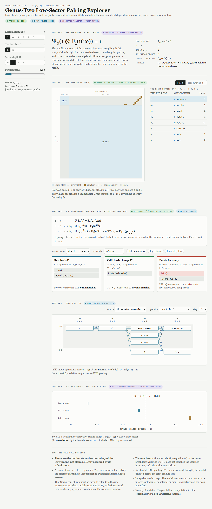

# Genus-two low-sector pairing

> **Standing:** `PROVISIONAL_WRITTEN_ARGUMENT` · `EXACT_MODEL_VERIFIED` · `GEOMETRIC_TRANSPORT_UNRESOLVED`

Permanent claim ID: `CBMD-ECH-G2-LS-001`

## Exact proposed result

For the genus-two prequantization bundle with Euler number (e=-b), (b\ge3), and torsion representative \(\Gamma\in\{1,2\}\), the proposed raw cap classes form filtered rational ECH bases at specified complete-sector cutoffs. In those bases, the (U)-map is given by the displayed low-sector recurrence, and compatible continuation would yield sixteen ungraded (U)-towers in the direct limit.

The algebraic pairing model and recurrence are proved at the written-argument level and corroborated by exact finite checks. Their identification with geometric ECH is not established here.

## What is established in this repository

- An explicit upper-triangular pairing model with one raw off-diagonal junction.
- Exactly eight nonzero junction entries and rank six.
- A denominator-free (U)-recurrence determined by (PU=Q).
- An integral coordinate shear that removes the junction only when all dependent data are transformed coherently.
- A second-reader grid audit showing that the one eight-entry off-diagonal block persists in all 16 declared extended cases through depth 6.
- Exact localization of the invalid-deletion control: 15 sector-one sources detect it in every one of the 36 audited primary-grid cases.
- Exact agreement with a pinned oracle on 3,951 operator vectors, 3,951 residual checks, and 23,706 repeated-(U) transitions.
- A deliberately incorrect deletion operator that fails the pairing equations while passing the relative model-weight test.

These are model statements and tests, not geometric certification.

## What remains unresolved

1. Whether the cap/fill composition and closed-invariant formulas apply to the unstable initial-sector representatives with the asserted relative classes, signs, and orientations.
2. Whether the strong-cobordism construction supplies the required filtered support statement in these sectors.
3. Whether the polynomial (u) insertion matches the geometric point action with the same conventions.
4. Whether the continuation gluing identity holds through the required deformation, chamber, insertion, orientation, and cutoff comparisons.
5. Whether the rational direct limit identifies the algebraic union with ECH in the asserted way.
6. Whether an existing Floer calculation already contains the result in other coordinates.
   A bounded ECH-side prior-art check confirmed §2 of the argument and left this
   question open; it did not examine the Heegaard–Floer route. See
   [`review/PRIOR_ART.md`](review/PRIOR_ART.md).

## Smallest decisive test

For \(g=2\), \(e=-3\), and \(\Gamma=1\), determine whether

\[
\Psi_0^\varepsilon\!\left(1\otimes F_1^\varepsilon(u^2\omega)\right)=1
\]

is justified by the proposed cap/fill composition argument. A confirmed value, first invalid insertion, sign correction, missing hypothesis, or prior-art coordinate match would materially advance the result.

## Read and explore

1. [Public verification dossier](argument/GENUS_TWO_LOW_SECTOR_REVIEW.md)
2. [Genus-Two Low-Sector Pairing Explorer](explorer/GENUS_TWO_LOW_SECTOR_PAIRING_EXPLORER.html) — GitHub displays the source; download the file and open it locally for the interactive version.
3. [Exact-model verification](verification/test_pairing_explorer.cjs)
4. [Second-reader grid audit](verification/grid-audit/LOW_SECTOR_GRID_AUDIT.md)
5. [Pinned model fixtures](verification/reference-fixtures.json)
6. [Claim record](CLAIM.json)



## Reproduce

From the repository root:

```text
python -B tools/validate_repository.py
python -B discoveries/ech/genus-two-low-sector/explorer/source/build.py --check
node discoveries/ech/genus-two-low-sector/verification/test_pairing_explorer.cjs
node discoveries/ech/genus-two-low-sector/verification/grid-audit/grid_audit.js
```

The first command checks repository structure and standing consistency. The second confirms that the standalone HTML is exactly generated from its template and model core. The third checks the finite algebra against the pinned oracle. The fourth recomputes the extended evidence-scope audit and requires exact equality with its pinned result. The Node.js checks use only the standard library.

The optional offline browser check is `node discoveries/ech/genus-two-low-sector/explorer/source/verify_offline.js`; it additionally requires Playwright and a supported browser.

## How to challenge this result

The most valuable response is the first exact failure in the geometric bridge. Please use the repository forms for a counterexample, proof gap, reproduction failure, or prior-art match and identify `CBMD-ECH-G2-LS-001`.

## Provenance and nonclaims

This public candidate is derived from a privately prepared specialist-review package, but contains no reviewer invitation, private correspondence, or implied reviewer association. The research and package preparation used substantial AI assistance.

No claim is made here of specialist approval, proof-assistant verification, novelty, an absolute ECH grading, integral or mod-two geometric maps, a constructed contact form with measured Reeb dynamics, or a completed continuation theorem.

## Revision history

- [`0.2.0-candidate`](revisions/0.2.0-candidate.md) — adds the neutral second-reader grid audit and sharpens what the adverse control can detect; no status promotion.
- `0.1.0-candidate` — first neutral public-repository projection; not yet published.
